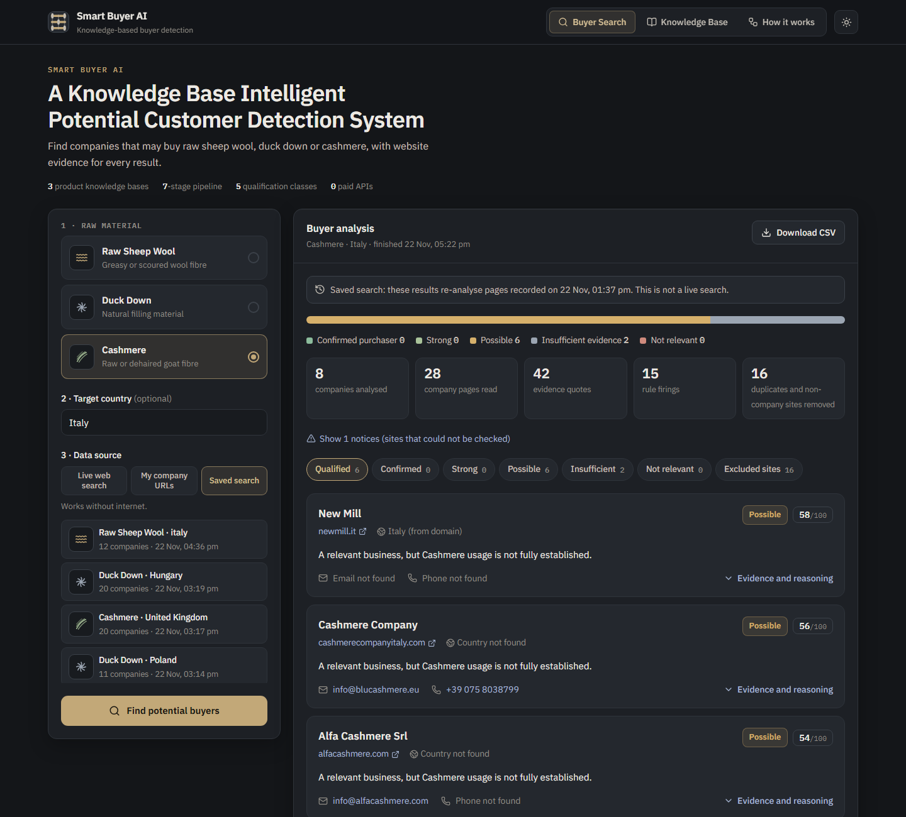
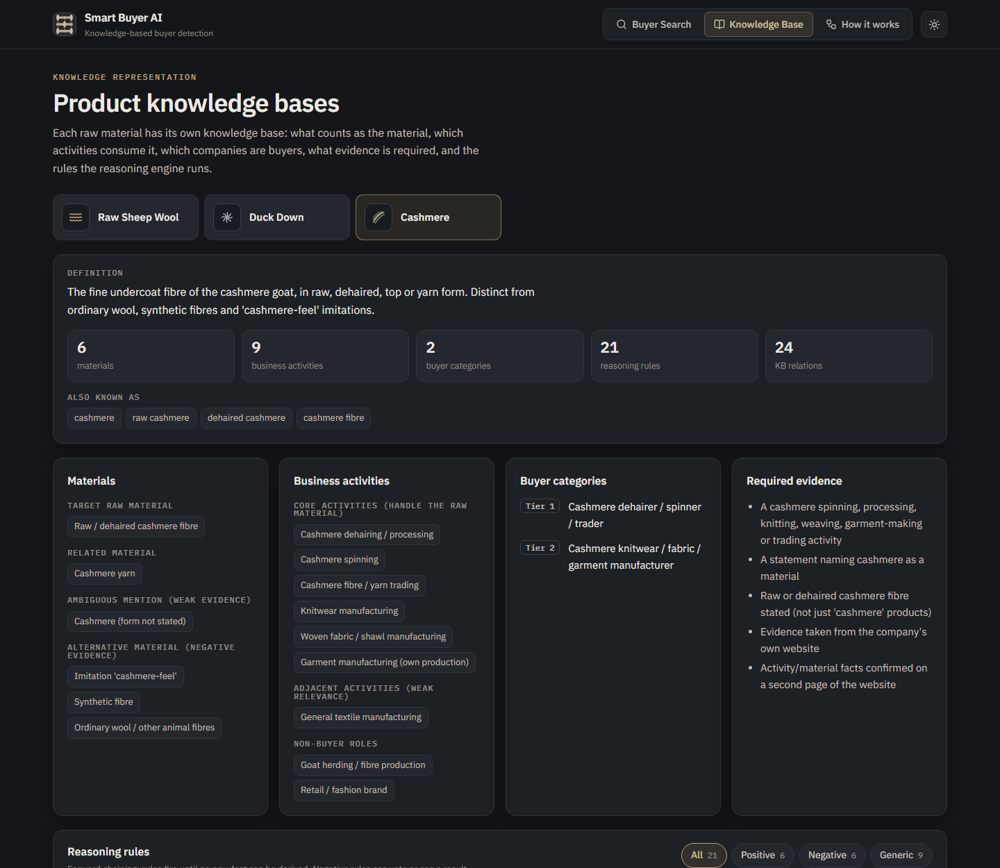
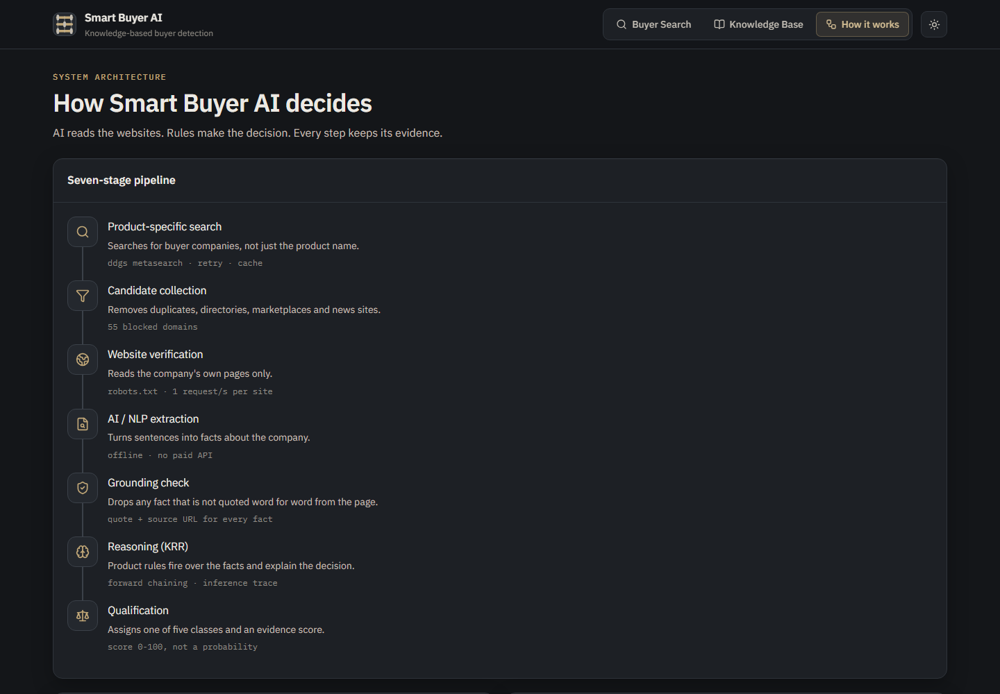

# Smart Buyer AI

**A Knowledge Base Intelligent Potential Customer Detection System**

Smart Buyer AI finds international companies that may buy **raw sheep wool**, **duck down** or
**cashmere**. For every company it shows *why* it was or was not selected: quotes from the
company's own website, the knowledge-base rules that fired, what evidence is missing, and an
explainable evidence score.

It replaces a keyword finder that accepted any page containing the product name *or* a buyer
word. On new, unseen companies the false-positive rate dropped from **85% to 15%**, and every
lead is backed by a verbatim quote from the company's own site.



| Knowledge base explorer | How it works |
|---|---|
|  |  |

---

## Features

- **Three product knowledge bases.** Each product has its own materials (target, related,
  ambiguous, alternative), business activities, buyer categories, required evidence and rules.
- **AI/NLP extraction, offline.** Website sentences become facts (activity, material, buying or
  selling, negation, exclusivity). No paid API is needed.
- **Grounding check.** A fact is kept only if its quote exists word for word on the fetched page,
  so the system cannot invent evidence.
- **Knowledge representation and reasoning.** Forward chaining over product-specific positive and
  negative rules, derived roles (retailer, supplier), conflict detection and a full inference trace.
- **Five classes.** Confirmed Purchaser, Strong Potential Buyer, Possible Potential Buyer,
  Insufficient Evidence and Not Relevant. A purchaser is "confirmed" only when the company's own
  site says it buys or sources the material.
- **Explainable evidence score (0-100).** It ranks companies inside a class and is not a probability.
- **Dashboard.** Live pipeline progress, class summary, evidence and reasoning per company,
  knowledge-base explorer, light and dark themes, CSV export.
- **Three data sources.** Live web search, your own list of company URLs, or a saved search that
  replays earlier results without internet (useful for demos).
- **Responsible crawling.** robots.txt, one request per second per site, public hosts only.

## How it works

```
Product + country
  1. Product-specific search     ddgs metasearch, retry with backoff, cache
  2. Candidate collection        URL normalisation, de-duplication, directory/news blocklist
  3. Website verification        homepage + About/Products/Contact/Sourcing pages
  4. AI/NLP extraction           facts with a quote and source URL
  5. Grounding check             facts whose quote is not on the page are dropped
  6. KRR reasoning               forward chaining, vetoes, caps, conflicts, trace
  7. Qualification + score       decision table -> 5 classes, evidence score
  -> dashboard + CSV
```

Search snippets are used only to find candidate companies, never as evidence.

## Results

Full report: [`docs/verification-report.html`](docs/verification-report.html).

| Test set | Method | Precision | Recall | False-positive rate |
|---|---|---|---|---|
| Fresh set B: 58 new companies, system frozen before testing | Old keyword finder | 68% | 55% | 85% |
| | **Smart Buyer AI** | **90%** | **43%** | **15%** |
| Real-world set A: 90 companies | Old keyword finder | 65% | 55% | 78% |
| | **Smart Buyer AI (v1)** | **83%** | **57%** | **30%** |

- **Evidence audit: pass.** 161 companies and 3,293 evidence quotes checked; none invented.
- **158 automated tests.**
- The system is cautious by design. It misses many real buyers (recall 43%), mainly because it
  reads English pages only.

## Tech stack

| Part | Technology |
|---|---|
| Backend | Python 3.12, FastAPI, BeautifulSoup, ddgs |
| Frontend | Next.js 15, React 19, TypeScript, Tailwind CSS |
| Tests | pytest (158 tests), labelled evaluation sets, automatic audit |

## Project structure

```
backend/
  app/
    knowledge/      schema.py (entities, facts, rule language), generic_rules.py,
                    products/{sheep_wool,duck_down,cashmere}.py   one knowledge base per product
    extraction/     nlp_extractor.py (offline NLP), grounding.py
    reasoning/      engine.py (forward chaining), qualification.py, scoring.py
    pipeline/       search_service.py, candidates.py, website.py, contacts.py, runner.py
    main.py         API, company_analysis.py, jobs.py
    finder.py       original keyword finder (kept as the evaluation baseline)
  data/snapshots/   saved searches for replay mode
  evaluation/       labelled data sets, frozen snapshots, results, audit
  tests/            pytest suite
  Dockerfile        Hugging Face Spaces image
frontend/           Next.js dashboard (app/, components/, lib/)
docs/               verification report and screenshots
```

## Run locally

**Backend** (Python 3.12 or newer):

```powershell
cd backend
python -m venv venv
venv\Scripts\Activate.ps1          # macOS/Linux: source venv/bin/activate
pip install -r requirements-dev.txt
uvicorn app.main:app --reload       # http://127.0.0.1:8000/docs
```

**Frontend** (Node.js 20 or newer):

```powershell
cd frontend
npm install
copy .env.example .env              # macOS/Linux: cp .env.example .env
npm run dev                         # http://localhost:3000
```

`BACKEND_API_URL` in `frontend/.env` points the dashboard at the backend.

## Deploy

The backend runs on **Hugging Face Spaces** (Docker) and the frontend on **Vercel**. Both are free.

### 1. Backend: Hugging Face Spaces

1. Go to <https://huggingface.co/new-space>.
2. Choose a name (for example `smart-buyer-ai-api`), **SDK: Docker**, template **Blank**,
   hardware **CPU basic (free)**, then create the Space.
3. Put the contents of the `backend/` folder at the root of the Space. `backend/README.md` already
   holds the Space configuration (`sdk: docker`, `app_port: 7860`). Use either option:
   - **Web upload:** in the Space, open *Files → Add file → Upload files* and upload everything
     inside `backend/` except `venv/`, `tests/` and `evaluation/`.
   - **Git:** from the repository root, run
     `git subtree push --prefix backend https://huggingface.co/spaces/<user>/<space> main`
     and use a Hugging Face access token (write) as the password.
4. Wait for the build to finish (status **Running**), then open
   `https://<user>-<space>.hf.space/health`. It should return `{"status":"ok"}`.

### 2. Frontend: Vercel

1. In Vercel, choose **Add New → Project** and import this GitHub repository.
2. Set **Root Directory** to `frontend`. The framework is detected as Next.js.
3. Add the environment variable **`BACKEND_API_URL`** = `https://<user>-<space>.hf.space`
   (no trailing slash).
4. Deploy and open the Vercel URL.

### Notes

- A free Space goes to sleep after a period without visitors. The first request then takes
  about a minute. Open the site once a few minutes before a demo.
- Live searches saved on the Space are lost when it restarts. The saved searches shipped in
  `backend/data/snapshots` are always available in *Saved search* mode.
- Some search providers limit requests from cloud servers. If a live search finds nothing,
  use *Saved search* or *My company URLs*.

## API

| Endpoint | Purpose |
|---|---|
| `POST /api/v2/search` | Start a search job: `{"product": "duck_down", "country": "Japan", "mode": "live"}`. `mode` is `live`, `seed` (with `seed_urls`) or `replay`. Returns `202` with a `job_id`. |
| `GET /api/v2/search/{job_id}` | Job status, stage, progress and, when done, the result |
| `GET /api/v2/knowledge/{product}` | The product's knowledge base, relations and rules |
| `GET /api/v2/snapshots` | Saved searches that can be replayed |
| `GET /api/v2/products` | The three supported products |
| `POST /api/search` | Original keyword finder (kept for comparison) |

## Tests and evaluation

```powershell
cd backend
python -m pytest -q                          # 158 tests
python -m evaluation.run_eval                # fictional labelled set
python -m evaluation.audit                   # evidence audit
python -m evaluation.real_world score ai     # real-world set A
python -m evaluation.real_world fresh-score  # fresh validation set B
```

## Limitations

- English pages only. Sites mostly in another language are marked *Insufficient Evidence*.
- Recall is low (43% on new companies) because the system prefers "not enough evidence" to a
  wrong lead.
- Companies with several websites can appear more than once.
- The real-world labels were produced by blind AI annotators. A first human check showed weak
  agreement, traced to two different readings of "buyer"; see the verification report.
